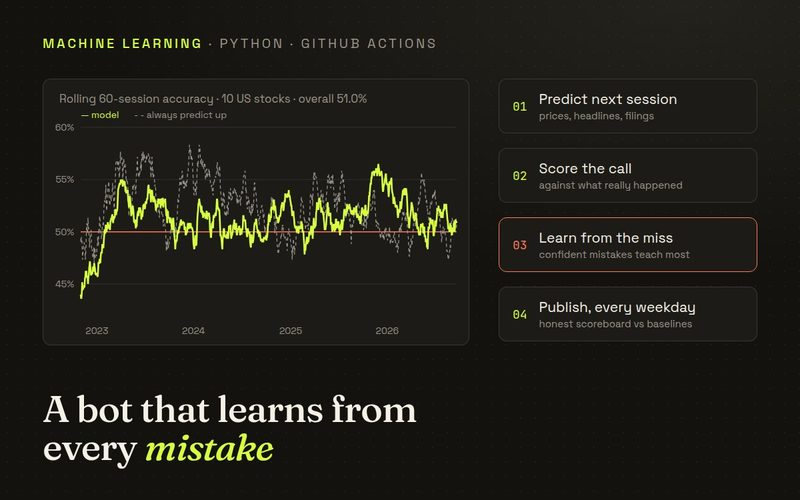
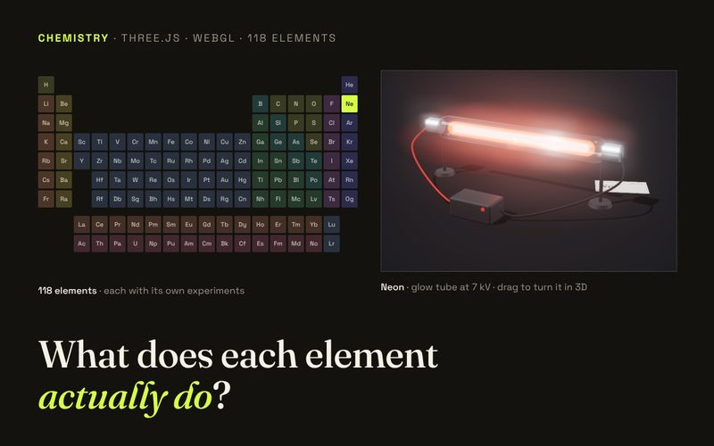
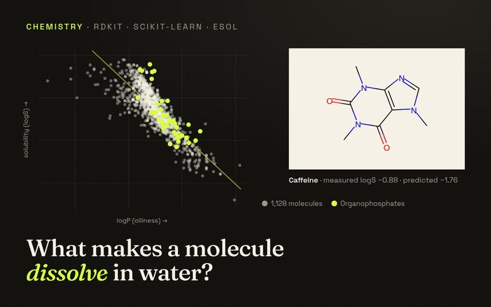
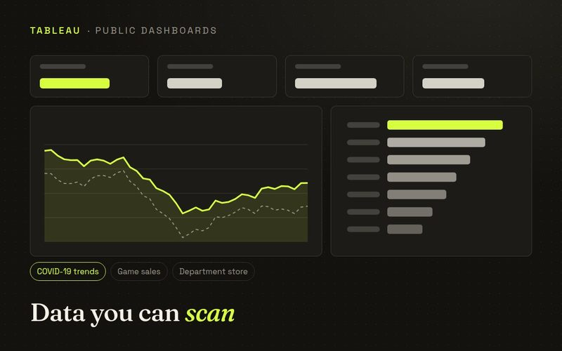
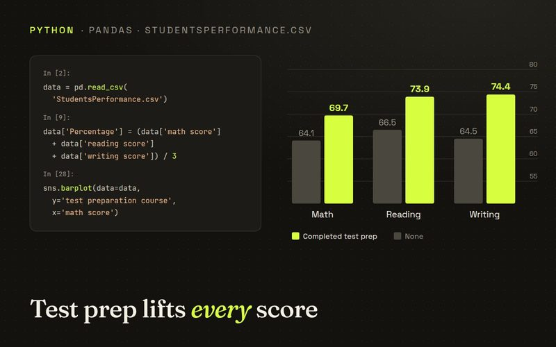
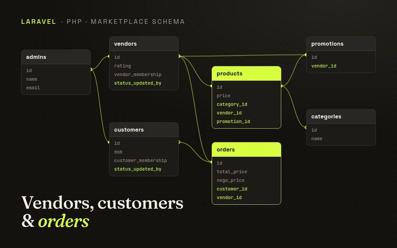

<h1 align="center">Steven Nathaniel Santoso</h1>

  Business Intelligence Analyst at StickEarn, based in Jakarta. 
  I build data pipelines and dashboards for work, and data and web projects on the side.

  <a href="https://porto-website-tan.vercel.app/cv/Steven-Nathaniel-Santoso-CV.pdf"><picture><source media="(prefers-color-scheme: dark)" srcset="assets/buttons/cv-dark.svg"></picture></a>
  <a href="https://porto-website-tan.vercel.app"><picture><source media="(prefers-color-scheme: dark)" srcset="assets/buttons/portfolio-dark.svg"></picture></a>
  <a href="https://www.linkedin.com/in/steven-nathaniel-santoso-10338a22a/"><picture><source media="(prefers-color-scheme: dark)" srcset="assets/buttons/linkedin-dark.svg"></picture></a>
  <a href="mailto:stevnatsan@gmail.com"><picture><source media="(prefers-color-scheme: dark)" srcset="assets/buttons/email-dark.svg"></picture></a>

---

### About me

I studied Computer Science at Binus University with a minor in database technology, and I've worked in data roles ever since. Right now I'm a BI Analyst at StickEarn, a startup, where I sit close to the founders and the sales, partnerships and operations teams. A lot of my job is figuring out what people actually need to see, then building the pipelines and dashboards that show it.

Outside work I like building things that sit between data and the screen people look at it on, so this profile has a mix of analysis, small ML experiments and interactive web pages.

### Experience

<table width="100%"><tr><td>

<h4>Business Intelligence Analyst · StickEarn</h4>
Mar 2025 to now · current role

- Built 10+ Metabase dashboards that ops, sales and partnerships check every day
- Made a company-wide "business health" view of revenue, margin and campaign execution
- Set up pipelines with Airflow, Airbyte and Python into BigQuery, replacing a lot of manual Google Sheets tracking
- Mapped where drivers cluster with Foursquare data (heatmaps, polygons) to suggest billboard spots for clients

<picture><source media="(prefers-color-scheme: dark)" srcset="assets/tools/bigquery-dark.svg"></picture> <picture><source media="(prefers-color-scheme: dark)" srcset="assets/tools/airflow-dark.svg"></picture> <picture><source media="(prefers-color-scheme: dark)" srcset="assets/tools/airbyte-dark.svg"></picture> <picture><source media="(prefers-color-scheme: dark)" srcset="assets/tools/metabase-dark.svg"></picture> <picture><source media="(prefers-color-scheme: dark)" srcset="assets/tools/python-dark.svg"></picture>

</td></tr></table>

<table width="100%"><tr><td>

<h4>ICT Intern · Sampoerna Agro</h4>
Nov 2024 to Feb 2025

- Built ETL pipelines in Talend for palm oil plantation data: yields, harvest schedules, supply chain
- Wrote SQL against the reporting databases and made Tableau dashboards for yield, workforce and cost

<picture><source media="(prefers-color-scheme: dark)" srcset="assets/tools/talend-dark.svg"></picture> <picture><source media="(prefers-color-scheme: dark)" srcset="assets/tools/sql-dark.svg"></picture> <picture><source media="(prefers-color-scheme: dark)" srcset="assets/tools/tableau-dark.svg"></picture>

</td></tr></table>

<table width="100%"><tr><td>

<h4>Data Engineering Intern · Samsung Research Indonesia</h4>
Mar 2023 to Feb 2024

- Built frontend features in React for an internal app, including a revamped email feature and a company detail page
- Spent a good amount of time on bug fixing and testing with the backend and design teams

<picture><source media="(prefers-color-scheme: dark)" srcset="assets/tools/react-dark.svg"></picture> <picture><source media="(prefers-color-scheme: dark)" srcset="assets/tools/javascript-dark.svg"></picture>

</td></tr></table>

<table width="100%"><tr><td>

<h4>Activist · HIMTI Binus</h4>
Sep 2021 to Nov 2022 · CS student association

- Ran events as PIC and made exam prep material for other CS students
- Where most of my Java practice and team lead experience came from

<picture><source media="(prefers-color-scheme: dark)" srcset="assets/tools/java-dark.svg"></picture>

</td></tr></table>

### What I'm working on

<table>
  <tr>
    <td width="50%" valign="top">
      
      <h4><a href="https://github.com/Stevnatsan/stock-prediction-lab">Stock Prediction Lab</a></h4>
      
A bot that runs every weekday on GitHub Actions. It pulls prices, headlines, earnings and analyst moves for a list of US stocks, has a few models guess the next day and week, and then scores itself against what actually happened. The honest result so far: it's about as right as "always guess up", and the scoreboard shows that openly. There's a phone page with the latest calls and news.

      

        <picture><source media="(prefers-color-scheme: dark)" srcset="assets/tools/python-dark.svg"></picture>
        <picture><source media="(prefers-color-scheme: dark)" srcset="assets/tools/scikit-learn-dark.svg"></picture>
        <picture><source media="(prefers-color-scheme: dark)" srcset="assets/tools/finbert-dark.svg"></picture>
        <picture><source media="(prefers-color-scheme: dark)" srcset="assets/tools/github-actions-dark.svg"></picture>
      

      
→ <a href="https://stevnatsan.github.io/stock-prediction-lab/">Phone page</a>

    </td>
    <td width="50%" valign="top">
      
      <h4><a href="https://porto-website-tan.vercel.app/periodic-table/">Element Specimens</a></h4>
      
An interactive 3D periodic table. Each of the 118 elements sits on a bench as a sample you can turn and pick up. You can heat it past its real melting and boiling points, drop caesium in water, flame-test strontium or light up neon. Each element also has a few real compounds with structure drawings and a journal source.

      

        <picture><source media="(prefers-color-scheme: dark)" srcset="assets/tools/threejs-dark.svg"></picture>
        <picture><source media="(prefers-color-scheme: dark)" srcset="assets/tools/webgl-dark.svg"></picture>
      

      
→ <a href="https://porto-website-tan.vercel.app/periodic-table/">Try it</a>

    </td>
  </tr>
  <tr>
    <td width="50%" valign="top">
      
      <h4><a href="https://github.com/Stevnatsan/molecule-solubility-analysis">Molecule Solubility</a></h4>
      
Why do some molecules dissolve in water and others don't? I used RDKit descriptors and a random forest on 1,128 molecules, then looked at where the model goes wrong. Organophosphates, for example, come out about twice as badly as average.

      

        <picture><source media="(prefers-color-scheme: dark)" srcset="assets/tools/python-dark.svg"></picture>
        <picture><source media="(prefers-color-scheme: dark)" srcset="assets/tools/rdkit-dark.svg"></picture>
        <picture><source media="(prefers-color-scheme: dark)" srcset="assets/tools/scikit-learn-dark.svg"></picture>
      

      
→ <a href="https://stevnatsan.github.io/molecule-solubility-analysis/">Dashboard</a>

    </td>
    <td width="50%" valign="top">
      
      <h4><a href="https://public.tableau.com/app/profile/steven.nathaniel.santoso/vizzes">Tableau dashboards</a></h4>
      
Dashboards on COVID case trends, game sales and department store performance. I tried to keep them easy to compare at a glance without hiding the numbers behind decoration.

      

        <picture><source media="(prefers-color-scheme: dark)" srcset="assets/tools/tableau-dark.svg"></picture>
      

      
→ <a href="https://public.tableau.com/app/profile/steven.nathaniel.santoso/vizzes">Tableau Public</a>

    </td>
  </tr>
  <tr>
    <td width="50%" valign="top">
      
      <h4><a href="https://github.com/Stevnatsan/Python-Collab">Python data analysis</a></h4>
      
Notebooks where I clean raw datasets, compare variables and chart the results. One example: students who finished a test prep course scored higher in math, reading and writing.

      

        <picture><source media="(prefers-color-scheme: dark)" srcset="assets/tools/python-dark.svg"></picture>
        <picture><source media="(prefers-color-scheme: dark)" srcset="assets/tools/pandas-dark.svg"></picture>
        <picture><source media="(prefers-color-scheme: dark)" srcset="assets/tools/seaborn-dark.svg"></picture>
      

    </td>
    <td width="50%" valign="top">
      
      <h4><a href="https://github.com/Stevnatsan/Web-Development">Web development</a></h4>
      
Full-stack projects with a real database behind them, like a marketplace with vendors, customers, products, promotions and orders. I built them around usability first, following Shneiderman's eight golden rules.

      

        <picture><source media="(prefers-color-scheme: dark)" srcset="assets/tools/laravel-dark.svg"></picture>
        <picture><source media="(prefers-color-scheme: dark)" srcset="assets/tools/php-dark.svg"></picture>
        <picture><source media="(prefers-color-scheme: dark)" srcset="assets/tools/javascript-dark.svg"></picture>
        <picture><source media="(prefers-color-scheme: dark)" srcset="assets/tools/mysql-dark.svg"></picture>
      

    </td>
  </tr>
</table>

### Tools I use

**Data** 
<picture><source media="(prefers-color-scheme: dark)" srcset="assets/tools/sql-dark.svg"></picture> <picture><source media="(prefers-color-scheme: dark)" srcset="assets/tools/bigquery-dark.svg"></picture> <picture><source media="(prefers-color-scheme: dark)" srcset="assets/tools/python-dark.svg"></picture> <picture><source media="(prefers-color-scheme: dark)" srcset="assets/tools/pandas-dark.svg"></picture> <picture><source media="(prefers-color-scheme: dark)" srcset="assets/tools/airflow-dark.svg"></picture> <picture><source media="(prefers-color-scheme: dark)" srcset="assets/tools/airbyte-dark.svg"></picture> <picture><source media="(prefers-color-scheme: dark)" srcset="assets/tools/metabase-dark.svg"></picture> <picture><source media="(prefers-color-scheme: dark)" srcset="assets/tools/tableau-dark.svg"></picture> <picture><source media="(prefers-color-scheme: dark)" srcset="assets/tools/talend-dark.svg"></picture> <picture><source media="(prefers-color-scheme: dark)" srcset="assets/tools/scikit-learn-dark.svg"></picture>

**Web** 
<picture><source media="(prefers-color-scheme: dark)" srcset="assets/tools/javascript-dark.svg"></picture> <picture><source media="(prefers-color-scheme: dark)" srcset="assets/tools/react-dark.svg"></picture> <picture><source media="(prefers-color-scheme: dark)" srcset="assets/tools/html-css-dark.svg"></picture> <picture><source media="(prefers-color-scheme: dark)" srcset="assets/tools/laravel-dark.svg"></picture> <picture><source media="(prefers-color-scheme: dark)" srcset="assets/tools/threejs-dark.svg"></picture>

**Other** 
<picture><source media="(prefers-color-scheme: dark)" srcset="assets/tools/google-cloud-dark.svg"></picture> <picture><source media="(prefers-color-scheme: dark)" srcset="assets/tools/git-dark.svg"></picture> <picture><source media="(prefers-color-scheme: dark)" srcset="assets/tools/docker-dark.svg"></picture> <picture><source media="(prefers-color-scheme: dark)" srcset="assets/tools/github-actions-dark.svg"></picture> <picture><source media="(prefers-color-scheme: dark)" srcset="assets/tools/java-dark.svg"></picture> <picture><source media="(prefers-color-scheme: dark)" srcset="assets/tools/c-dark.svg"></picture>

---

  The best way to reach me is <a href="mailto:stevnatsan@gmail.com">email</a>, or you can book a short chat through my <a href="https://porto-website-tan.vercel.app/#contact">portfolio</a>.

